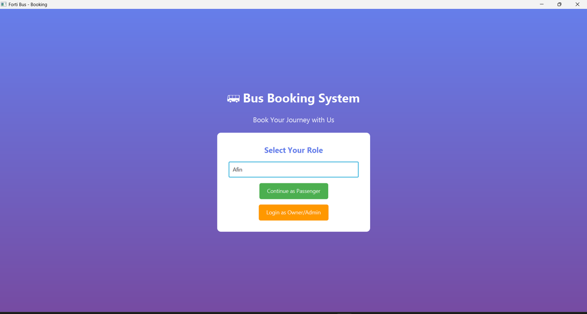
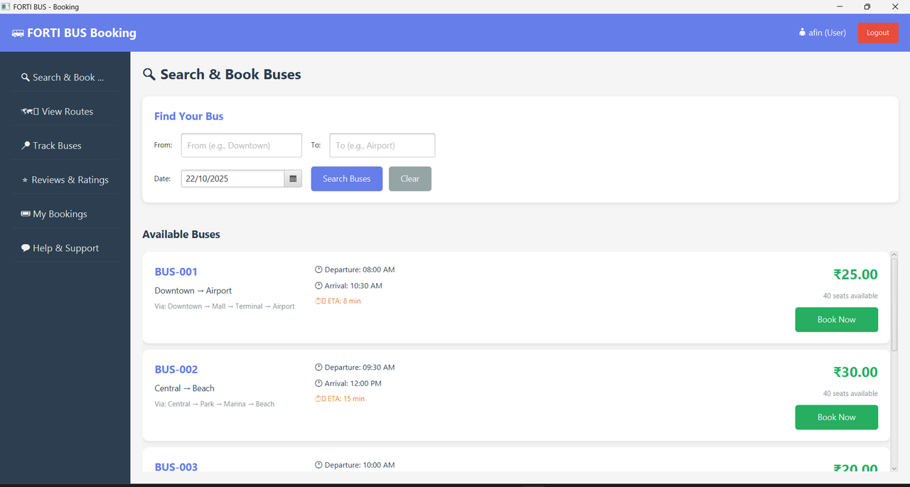
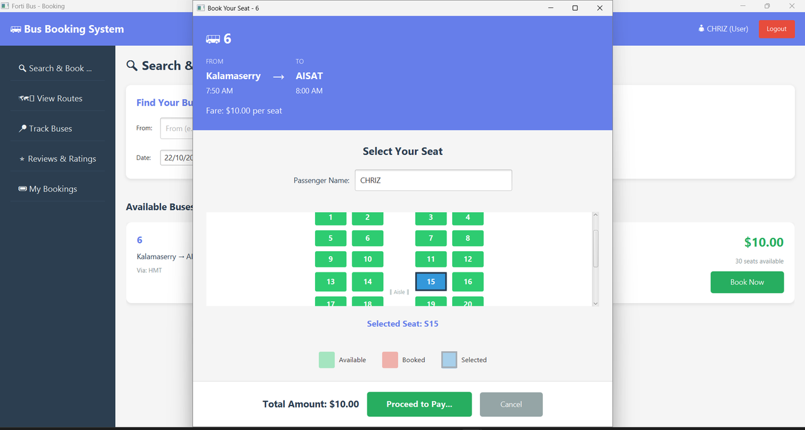
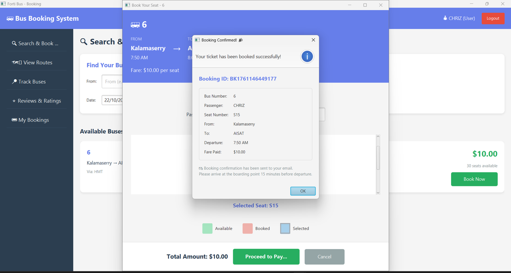
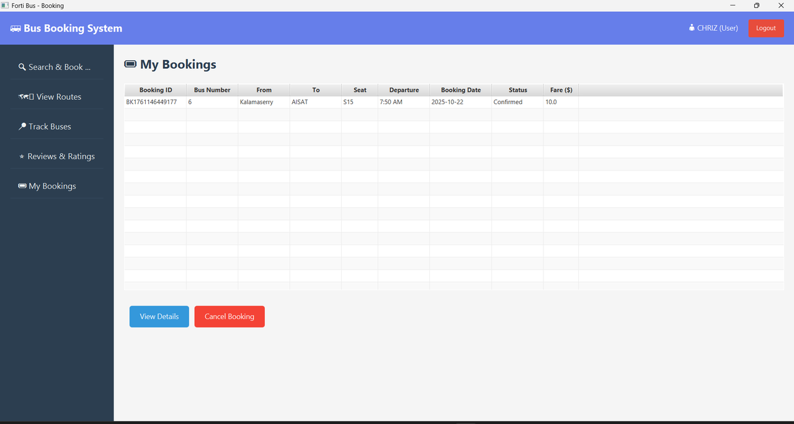
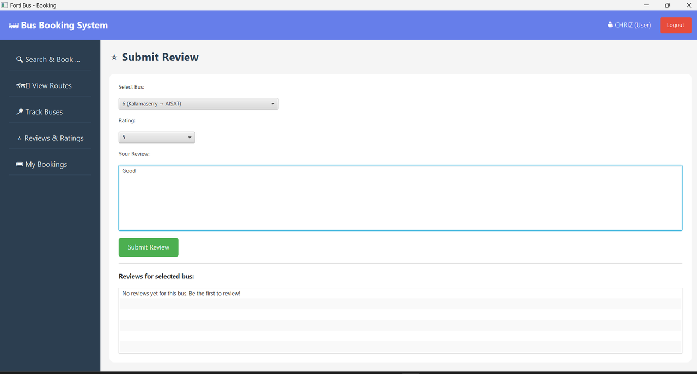
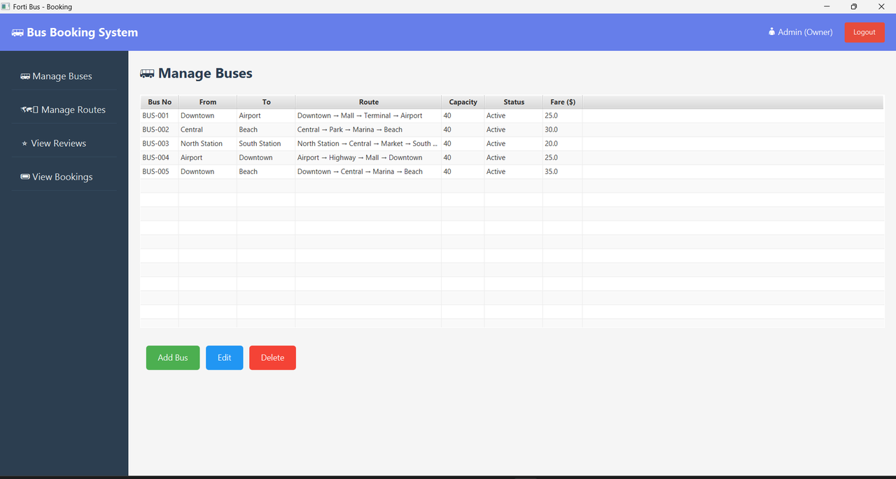
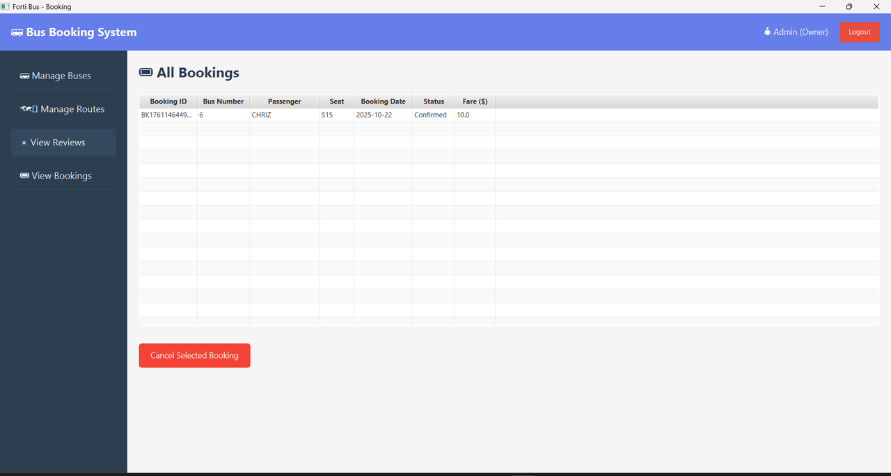
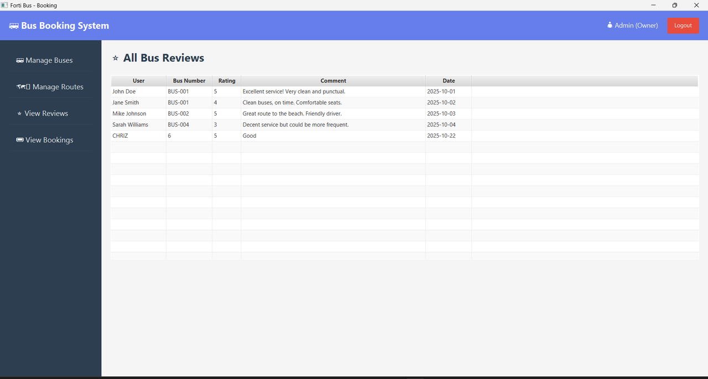

# 🚌 FORTI BUS — Bus Booking System

A desktop bus booking application built with **Java** and **JavaFX**. Passengers can search buses, pick a seat on a visual seat map, pay (simulated) and manage their tickets; owners/admins can manage buses, routes, bookings and reviews.

Developed as a course project for **PBCST304 – Object Oriented Programming**, B.Tech Computer Science and Engineering, **Albertian Institute of Science and Technology (AISAT), Kalamassery, Kochi**.


---

## Table of Contents

- [Features](#features)
- [Screenshots](#screenshots)
- [Tech Stack](#tech-stack)
- [Object-Oriented Design](#object-oriented-design)
- [Getting Started](#getting-started)
- [Usage](#usage)
- [Project Structure](#project-structure)
- [Limitations](#limitations)
- [Future Scope](#future-scope)
- [Team](#team)

---

## Features

### Passenger
- **Search & filter** buses by *From* and *To*.
- **Bus cards** showing departure/arrival time, fare, ETA and live seat availability.
- **Seat booking** on a graphical seat grid (4 seats per row with an aisle) — booked seats are red and disabled, available seats are green, your selection is blue.
- **Payment dialog** (simulated) with Card, UPI and Net Banking options, followed by a booking confirmation with a unique Booking ID.
- **My Bookings** — view confirmed/cancelled tickets and cancel a booking.
- **View Routes** and **Track Buses** (status and ETA table).
- **Reviews & ratings** — rate a bus (1–5) and leave a comment.

### Owner / Admin
- **Manage Buses** — add, edit and delete buses in a table view.
- **Manage Routes** — define and update routes, stops and base fares.
- **View All Bookings** — see every booking and cancel tickets.
- **View Reviews** — monitor passenger feedback.

---

## Screenshots

| Login / role selection | Passenger – search & book |
|:--:|:--:|
|  |  |

| Seat selection | Booking confirmation |
|:--:|:--:|
|  |  |

| My Bookings | Submit a review |
|:--:|:--:|
|  |  |

| Admin – manage buses | Admin – all bookings |
|:--:|:--:|
|  |  |

| Admin – reviews |
|:--:|
|  |

> Some screenshots were captured during development and may show earlier titles or the `$` currency symbol; the current build uses the **FORTI BUS** branding and **₹**.

---

## Tech Stack

| Area | Technology |
|---|---|
| Language | Java |
| GUI | JavaFX |
| Build tool | Maven (Maven Wrapper included) |
| IDE | IntelliJ IDEA |
| Data storage | In-memory `ObservableList` collections |

---

## Object-Oriented Design

| Class | Responsibility | Key attributes (private) |
|---|---|---|
| `Bus` | A bus and its schedule | busNumber, from, to, route, capacity, status, eta, fare, departureTime, arrivalTime |
| `Route` | A travel route | routeName, from, to, stops, fare |
| `Booking` | A passenger's ticket | bookingId, busNumber, passengerName, seatNumber, status |
| `Review` | Passenger feedback | userName, busNumber, rating, comment, date |
| `BusBookingApp` | Main JavaFX application, UI and logic | busList, routeList, bookingList, reviewList, userRole, currentUserName |

- **Encapsulation** – all model fields are `private`, accessed only through getters/setters.
- **Abstraction** – `BusBookingApp` hides seat-availability calculation and payment simulation behind simple UI actions.
- **Data synchronisation** – JavaFX `ObservableList` keeps `TableView`/`ListView` components in sync with the underlying data automatically.
- **Inheritance & polymorphism** – planned for future versions (e.g. `SleeperBus`, `ACBus` overriding `calculateFare()`).

---

## Getting Started

### Prerequisites
- **JDK 17 or later**
- Git
- (Optional) IntelliJ IDEA

### Clone and run

```bash
git clone https://github.com/<your-username>/next-vision-bus.git
cd next-vision-bus
```

Using the Maven Wrapper (no separate Maven install needed):

```bash
# Linux / macOS
./mvnw clean javafx:run

# Windows
mvnw.cmd clean javafx:run
```

### Run from IntelliJ IDEA
1. Open the project folder (**File → Open**, select `pom.xml`).
2. Let Maven import the dependencies.
3. Run the `BusBookingApp` class.

---

## Usage

1. **Launch** the app — you'll see the *Select Your Role* screen.
2. **As a passenger:** enter your name → **Continue as Passenger** → search a route → **Book Now** → choose a seat → **Proceed to Pay** → note your Booking ID.
3. **As an admin:** click **Login as Owner/Admin** (no password) → use the sidebar to manage buses, routes, bookings and reviews.

The app starts with sample data: 5 buses (`BUS-001` … `BUS-005`), 3 routes (Route A–C) and a few reviews.

---

## Project Structure

```
next-vision-bus/
├── .mvn/            # Maven Wrapper config
├── src/             # Java sources (BusBookingApp and model classes)
├── docs/screenshots # README images
├── mvnw, mvnw.cmd   # Maven Wrapper scripts
└── pom.xml          # Maven build file
```

---

## Limitations

This is a learning project, so some parts are intentionally simplified:

- **No persistence** — all data lives in memory and resets when the app closes.
- **Payment is simulated** — no real gateway; card details are not validated or stored.
- **Role selection has no authentication** — anyone can choose the Owner/Admin role.
- **"Tracking" is static** — status and ETA are stored fields, not a live GPS feed.

---

## Future Scope

- Database integration (SQL or Firestore) for permanent storage.
- Full inheritance hierarchy for bus types, with polymorphic fare calculation (e.g. peak-hour pricing).
- Real-time tracking by connecting the `eta` field to a simulated or real GPS feed.
- Proper login with admin credentials.

---

## Team

| Name | Roll No. |
|---|---|
| Chriz Ben Biju | 23 |
| Ken Joe Augustine | 38 |
| Afin T Sony | 09 |
| Abin Binoy | 04 |
| Jince P J | 34 |

**Department:** Computer Science and Engineering, AISAT, Kalamassery, Kochi – 682022 (2024–2028 batch)
**Faculty in charge:** Anna Isabel John
**Course:** PBCST304 Object Oriented Programming — project evaluation held on 23 October 2025

---

## References

1. Java Platform, Standard Edition (Java SE) Documentation.
2. Oracle. *Learning JavaFX*.
3. Gamma, E., Helm, R., Johnson, R., & Vlissides, J. (1994). *Design Patterns: Elements of Reusable Object-Oriented Software*. Addison-Wesley.
